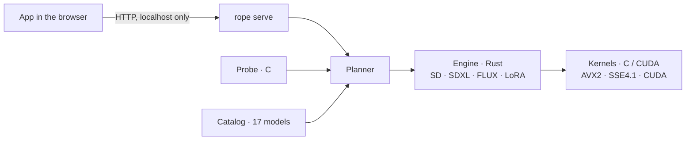
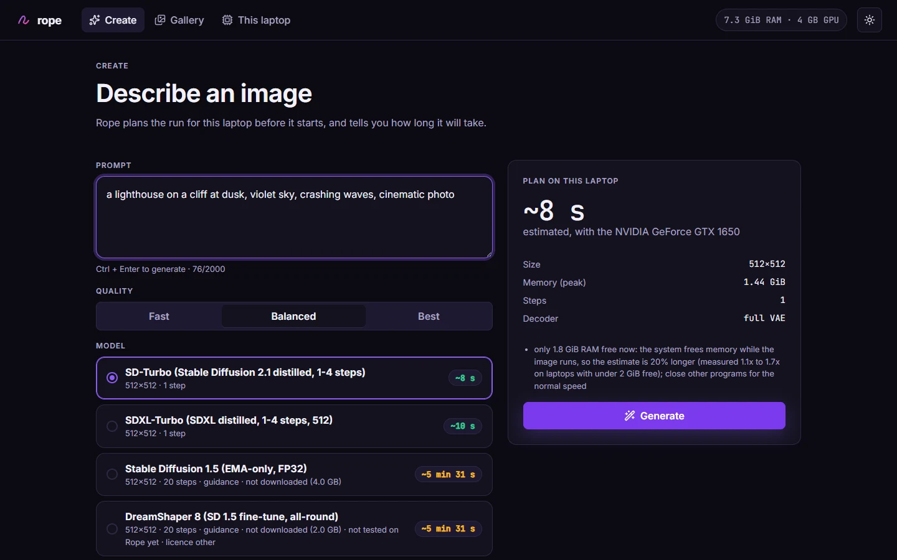

<div align="center">


<h1>Rope</h1>

<p><b>Big AI image models. Everyday laptops.</b><br/>
Rope reads your laptop, picks the image model that fits it, and tells you how long a picture will take — before it starts.<br/>
Offline. Free. No account. No graphics card needed.</p>

<p>
<a href="https://github.com/jayaprakash-pixel/rope/releases/latest/download/Rope-Setup.exe"></a>
<a href="https://rope-ai.vercel.app"></a>
</p>

<p>


</p>

</div>

---

## Made on one ordinary laptop

<table>
<tr>
<td></td>
<td></td>
<td></td>
</tr>
<tr>
<td></td>
<td></td>
<td></td>
</tr>
</table>

<sub>SDXL-Turbo: about 15 s per picture. FLUX.1-schnell (12 B parameters): about 115 s. All on a 2021 laptop: Ryzen 5 5600H, 8 GB RAM, GTX 1650 with 4 GB.</sub>

## Why Rope

AI image tools assume a big graphics card. Most laptops don't have one — they crash with "out of memory", or run for an hour without a word. **Rope measures the laptop first, then plans the run so it fits**: the right model, picture size, steps and decoder, plus an honest time estimate. If something cannot fit, it says why.

| | |
|---|---|
| 🧠 **One engine, any laptop** | Written from scratch in Rust and C: AVX2 and SSE4.1 kernels for any 64-bit processor, CUDA for NVIDIA cards. No Python, no PyTorch. |
| ⏱️ **Honest time, before you start** | Every plan states the seconds. On real laptops the plan was within 25% on 7 of 9 runs. |
| 👀 **Live preview and steering** | Watch the picture form step by step. Pause, resume, or change the prompt halfway. |
| 📦 **Bring your own model** | Paste the path of a model file you already have — even a big one. Rope checks it and finds a way: stream it from disk, shrink it once (Q8_0 / Q4_K), or use a smaller size. |
| 🎨 **LoRA and 4× upscaler** | Add LoRA style files with a strength slider; upscale 512 → 2048 in tiles inside the same memory limit. |
| 🔒 **Private by design** | Offline after the one model download. No account, no telemetry. Every model file is hash-checked and safety-scanned before first use; pickle files are never opened. |
| 🔌 **For developers** | A documented local HTTP API ([docs/HTTP_API.md](docs/HTTP_API.md)) and a C library (`librope`) with C and Python examples. |

## Install

1. **[Download Rope-Setup.exe](https://github.com/jayaprakash-pixel/rope/releases/latest/download/Rope-Setup.exe)** (2.5 MB, Windows 10 or 11, 64-bit).
2. Open it. Rope is **not code-signed yet**, so Windows may show *"Windows protected your PC"*: click **More info → Run anyway**. It installs for your user only — no administrator rights.
3. The setup reads your laptop, shows the model that fits and its download size, and asks before it downloads.
4. Start **Rope** from the Start menu. It opens in your browser.

Check the download: the SHA-256 fingerprint of `Rope-Setup.exe` is in the [release notes](https://github.com/jayaprakash-pixel/rope/releases/latest). Remove Rope with *Settings → Apps → Rope → Uninstall*.

| Requirement | |
|---|---|
| System | Windows 10 or 11, 64-bit |
| Memory | 4 GB RAM to start, 8 GB recommended |
| Disk | 3–15 GB free, depending on the model |
| Graphics | Not needed. An NVIDIA GTX 10-series or newer is used when present |
| Internet | Once, for the model download |

## How it works

```
 1. Read the laptop       rope probe     CPU + vector units, free RAM, GPU, disk speed, power source
 2. Plan the run          rope plan      model, size, steps, decoder, peak memory, seconds — or "does not fit", with the reason
 3. Make the picture      rope image     streamed weights, live previews, pause / change the prompt at the next step
 4. Keep it               gallery        prompt, seed and time saved; the time is compared with the plan
```



Each picture runs in its own process, so memory goes back to Windows when it ends.

<p align="center"></p>

## Models

Rope runs four families: **Stable Diffusion 1.x**, **Stable Diffusion 2.x** (SD-Turbo), **SDXL** (SDXL-Turbo, SDXL-Lightning, fine-tunes) and **FLUX.1-schnell** (GGUF, quantized). The catalog holds 17 models, from 2 GB to 12 GB files. 13 of them were added from their file header and Hugging Face metadata (same architecture as a tested model) and are marked *not tested on Rope yet*.

Each model has its own licence, shown in the app. Read it before you use the pictures.

## Status — v0.1.0

| Built and tested | Works, with limits | Roadmap |
|---|---|---|
| SD 1.5, SD 2.x / SD-Turbo, SDXL / SDXL-Turbo, FLUX.1-schnell | 13 of 17 catalog models checked from the header, not run yet | Video models (Wan 2.x) |
| CPU (AVX2, SSE4.1) and NVIDIA CUDA | GPU time estimates 30–40% optimistic on RTX 30-series laptops | Text models (LLMs) |
| Planner: model, size, steps, decoder, memory, time | Linux: command-line test program, processor only | macOS (Apple silicon) |
| Live preview, pause, prompt change | Installer not code-signed | Code-signed installer |
| LoRA, 4× upscaler, your own model files | Models download from the installer or CLI, not the app | Download button in the app |
| Browser app, HTTP API, C library, Windows installer | | ControlNet |

## Build from source

Needs Rust (stable), CMake, Visual Studio 2022 Build Tools (C), Node.js 20+, and the CUDA toolkit for the GPU build.

```powershell
powershell -File engine\build.ps1                 # build\rust-cpu\...\rope.exe (+ build\rust-cuda\... with CUDA)
cd app; npm install; npm run build; cd ..          # the browser app -> app\dist
powershell -File installer\build-installer.ps1    # build\installer\Rope-Setup.exe
```

Linux (Ubuntu 22.04+, processor only): `bash engine/build-linux.sh` builds in Docker. The website lives in `site/` (Vite, React, three.js, GSAP, Motion).

Command line:

```text
rope probe                 what this laptop has
rope suggest               every catalog model: runs here? time, size, memory
rope plan                  the plan for the best model on this laptop
rope image --prompt "..."  make a picture (--model <file> for your own)
rope check-model <file>    can this laptop run this file, and how?
rope app                   start the app and open it in the browser
```

## Repository

| Folder | What is in it |
|---|---|
| `engine/` | The engine: Rust (`rust/`), C and CUDA kernels (`src/`), the C header `include/rope.h` |
| `app/` | The browser app (React) |
| `catalog/` | The model catalog: files, sizes, SHA-256, licences, calibration |
| `installer/` | The Windows setup (IExpress, built into Windows) |
| `site/` | The website |
| `bench/` | Measurements and the check scripts behind every "tested" claim |
| `docs/` | HTTP API reference |
| `examples/` | API and library examples (Python, C) |

## Licence

Rope is released under the [MIT licence](LICENSE). The AI models it downloads are made by others and keep their own licences.
